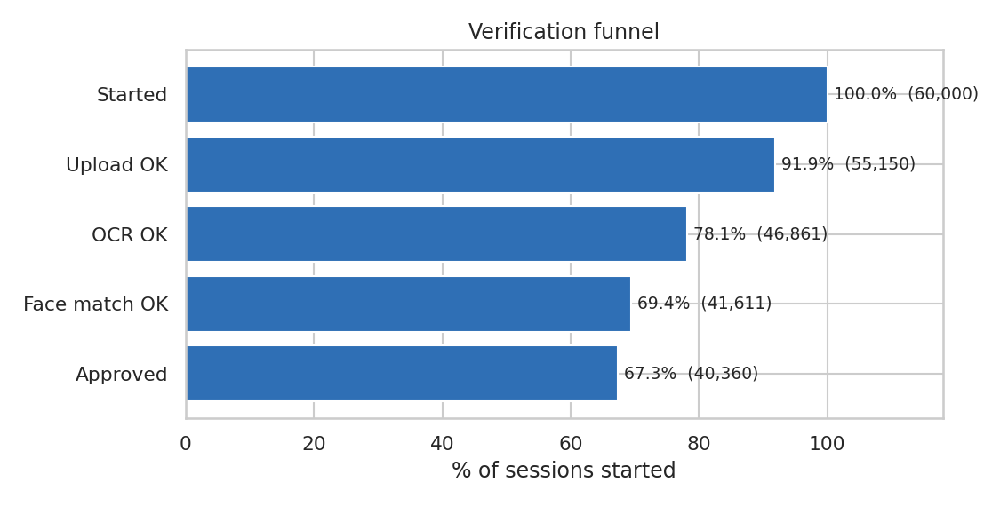
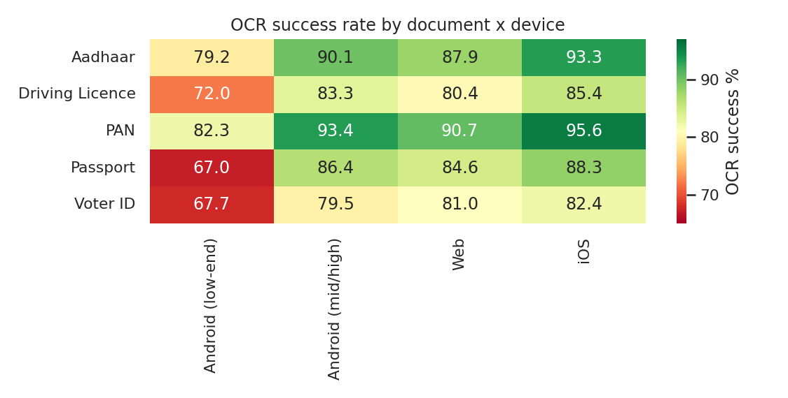
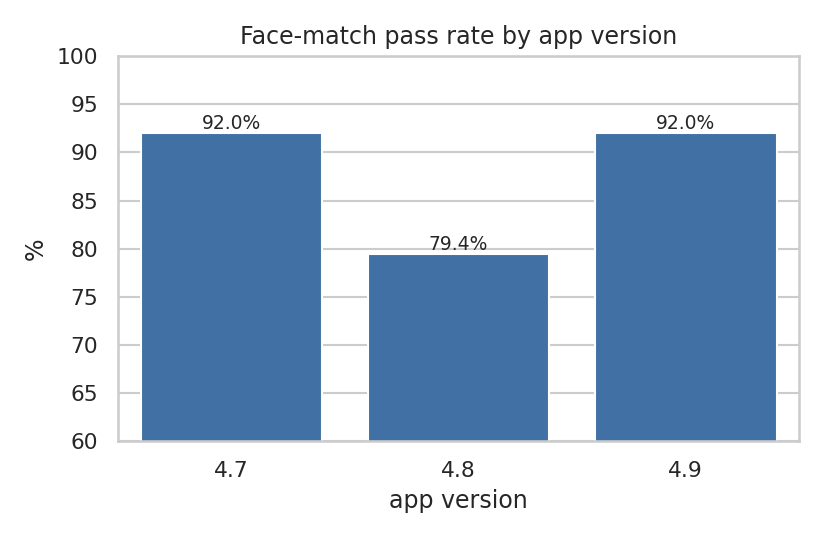
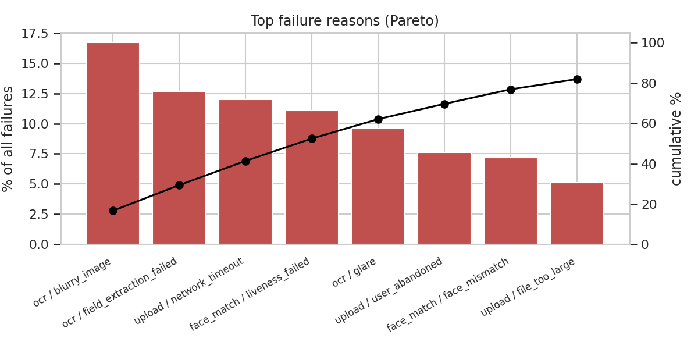
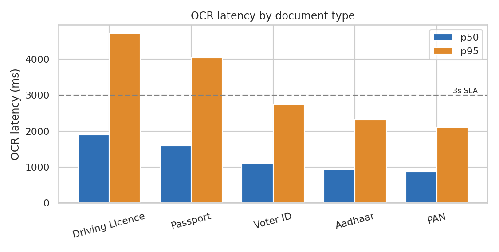

# Identity Verification Funnel Analysis

> **Where do users drop off during digital identity verification, why, and what would fixing it be worth?**

An end-to-end product-analytics case study on a **simulated** KYC / identity-verification funnel
(document upload → OCR → face match → approval). It uses **SQL** for the funnel and segment queries,
**Python (pandas, matplotlib, seaborn)** for latency benchmarking and charts, and ends with
**quantified recommendations** for Product and Engineering.

> ⚠️ **Data disclosure:** the dataset is **synthetic** (60,000 sessions, 1–30 Sep 2026, generated by
> `src/generate_data.py` with a fixed seed). No real user data is used. The drop-off patterns were planted
> deliberately so the analysis has realistic problems to find. The point of this project is the
> *method* — funnel analysis, segmentation, root-cause analysis and impact sizing — not the specific numbers.

## Business questions
1. Where is the biggest leak in the verification funnel?
2. Which document types and devices have the worst OCR success rate?
3. Why do verifications fail? (failure-reason Pareto)
4. Did a specific app release cause a regression?
5. Which document types breach a latency SLA?
6. What is each fix worth in approval-rate points?

## Key findings

**Overall approval is 67.3%.** The biggest absolute leak is at **OCR (85.0% step conversion)**, followed by face match (88.8%) and upload (91.9%).



| Stage | Sessions | % of start | Step conversion |
|---|---|---|---|
| Started | 60,000 | 100.0% | – |
| Upload OK | 55,150 | 91.9% | 91.9% |
| OCR OK | 46,861 | 78.1% | 85.0% |
| Face match OK | 41,611 | 69.4% | 88.8% |
| Approved | 40,360 | 67.3% | 97.0% |

### 1. OCR failures concentrate on low-end Android
Passport (67.0%), Voter ID (67.7%) and Driving Licence (72.0%) on low-end Android are the weakest segments, versus 86–95% on iOS.
`blurry_image` is the #1 failure reason overall (16.7% of all failures).



### 2. App v4.8 introduced a face-match regression
Face-match pass rate is **79.4% on v4.8** versus **92.0% on v4.7 and v4.9**, and `liveness_failed` dominates the v4.8 failures.



### 3. Four reasons explain over half of all failures
`blurry_image`, `field_extraction_failed`, `network_timeout` and `liveness_failed` account for 52.5% of failures.



### 4. Driving Licence and Passport OCR are the latency outliers
Driving Licence p95 is **4.7s** with **18.5% of calls over a 3s SLA** (Aadhaar and PAN: about 2.1–2.6% of calls over 3s).



## Recommendations and estimated impact
Impact = approval-rate points gained if the affected segment reached the benchmark level.

| # | Recommendation | Benchmark | Est. gain |
|---|---|---|---|
| 1 | Roll back or hotfix the v4.8 liveness check | v4.8 face-match 79.4% → 92.0% (v4.9) | **+2.5 pts** |
| 2 | Add on-device capture guidance (blur/glare detection, auto-focus, retake prompt) for low-end Android | OCR 76.0% → 88.2% (mid/high Android) | **+2.7 pts** |
| 3 | Add low-light prompts and a flash/brightness hint for night sessions | night face-match 83.5% → 89.1% (day) | +0.3 pts |
| 4 | Investigate Driving Licence OCR model/service latency; add timeout + retry budget | cut >3s calls from 18.5% | latency / UX |

Fixes 1 and 2 together are worth roughly **+5 approval-rate points** (about 3,000 extra verified users per 60,000 sessions).

## Repo structure
```
├── data/verification_sessions.csv   # synthetic dataset (generated)
├── sql/                             # analysis queries (portable SQL + one PostgreSQL file)
│   ├── 00_schema_postgres.sql
│   ├── 01_funnel_overall.sql
│   ├── 02_ocr_by_doc_and_device.sql
│   ├── 03_failure_reasons.sql
│   ├── 04_app_version_regression.sql
│   └── 05_latency_benchmark_postgres.sql
├── src/generate_data.py             # builds the synthetic data (seeded)
├── src/analysis.py                  # runs SQL, builds charts, sizes impact
├── images/                          # charts used in this README
└── reports/findings.txt             # full numeric output
```

## How to run
```bash
pip install -r requirements.txt
python src/generate_data.py   # creates data/verification_sessions.csv
python src/analysis.py        # runs SQL (via SQLite), saves charts + reports/findings.txt
```
To use PostgreSQL instead, run `sql/00_schema_postgres.sql`, load the CSV with `\copy`, then run the queries in `sql/`.

## Skills demonstrated
SQL (CTEs, window functions, conditional aggregation) · funnel and segment analysis · root-cause analysis ·
performance benchmarking (p50/p95 latency vs SLA) · impact sizing · data visualization · clear
recommendations for Product and Engineering.

## Limitations
- Synthetic data: effects are planted, so findings illustrate method, not real-world magnitudes.
- Impact sizing assumes segments can reach the benchmark level and that downstream conversion stays constant.
- No statistical significance testing is included; a natural next step is a two-proportion z-test per segment.
